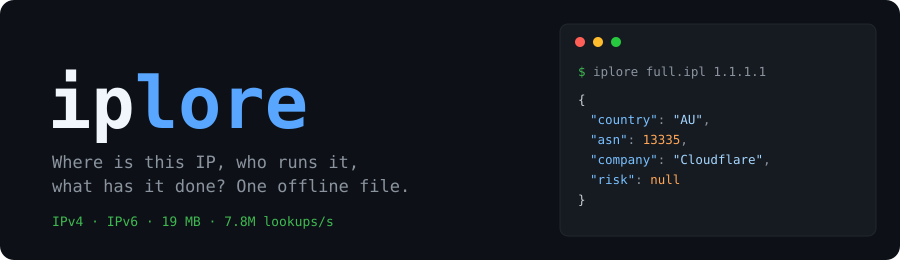

<p align="center">
  
</p>

<p align="center">
  <a href="https://github.com/tn3w/iplore/releases/latest"></a>
  <a href="https://github.com/tn3w/iplore/actions/workflows/ci.yml"></a>
  <a href="LICENSE"></a>
</p>

```sh
cargo install --git https://github.com/tn3w/iplore reader
curl -LO https://github.com/tn3w/iplore/releases/latest/download/iplore-full.ipl

iplore iplore-full.ipl 1.1.1.1
```

```json
{
  "place": {"lat": -33.8679, "lon": 151.2073, "accuracy": 100, "confidence": 60,
    "city": {"name": "Sydney", "timezone": "Australia/Sydney"},
    "country": {"code": "AU", "name": "Australia", "currency": "AUD"}},
  "network": {"asn": 13335, "handle": "CLOUDFLARENET", "prefix": 24, "rpki": "valid",
    "operator": {"company": "Cloudflare, Inc.", "category": "cdn",
      "abuse_email": "abuse@cloudflare.com"}},
  "abuse": {"risk": null, "service": null, "flags": ["anycast"]}
}
```

Quick check without installing anything: [iplore.tn3w.dev](https://iplore.tn3w.dev/).

Missing values are `null`. Reserved addresses (private, loopback, …) answer nothing.
IPv4, IPv6, v4-mapped, `[addr]:port` and `%zone` are accepted (no surrounding whitespace);
anything else is an invalid address (CLI exit 2).

## CLI

| command | does |
| --- | --- |
| `iplore <file> <address>` | JSON answer |
| `iplore <file> --about` | fields, vocabularies, sources, licenses |
| `iplore <file> --bench` | open time, cold and warm lookups, peak memory |

## Python, JavaScript, edge

```sh
release=https://github.com/tn3w/iplore/releases
pip install iplore --no-index -f $release/expanded_assets/bindings   # Python 3.9+
curl -LO $release/download/bindings/iplore.tgz && npm install ./iplore.tgz   # Node, Bun, Deno, Workers
```

```python
iplore.open("iplore-full.ipl").lookup("1.1.1.1")["network"]["asn"]  # 13335
```

```ts
(await open(await fetch(url))).lookup("1.1.1.1").network?.asn;  // 13335
```

Workers setup and a full example: [CONTRIBUTING](.github/CONTRIBUTING.md#edge-workers).

## Downloads

Built every Sunday, newest 3 releases kept.
`releases/latest/download/<file>` always points at the current build. Verify with
`sha256sum -c SHA256SUMS --ignore-missing` or `gh attestation verify <file> -R tn3w/iplore`.

| file | use case | size |
| --- | --- | ---: |
| `iplore-full.ipl` | IP intelligence, everything | 19.2 MB |
| `iplore-place.ipl` | geolocation, geo-routing, analytics | 6.4 MB |
| `iplore-country.ipl` | country blocking, compliance, localization | 0.5 MB |
| `iplore-network.ipl` | ASN and operator lookup, abuse contacts | 6.2 MB |
| `iplore-traffic.ipl` | bot and fraud triage: ASN, hosting / residential / mobile | 1.5 MB |
| `iplore-anonymizer.ipl` | detect VPN, proxy, Tor, private relay | 2.2 MB |
| `iplore-abuse.ipl` | risk scoring: services, providers, threat risk | 5.3 MB |
| `blocklist.netset` | web server protection: 418k CIDRs for nginx, ipset, nftables | 7.2 MB |

Need another cut? `builder abuse.service=tor_exit_node` builds a 10 KB Tor-only file,
see [CONTRIBUTING](.github/CONTRIBUTING.md).

## Fields

| group | fields |
| --- | --- |
| `place` | `lat` `lon` `accuracy` (km) `confidence` (0–100), `city`, `region`, `country` |
| `network` | `asn` `handle` `prefix` `rir` `year` `rpki` `users` `mobile_code` `risk`, `operator` |
| `abuse` | `risk` `threat` `reports` `last_seen_days` `service` `evidence` `provider` `user_type` `flags` |

49 fields in total, `iplore <file> --about` lists them.

## Web servers

Caddy, Traefik and nginx add `X-Iplore-Country`, `-Asn`, `-Category`, `-Risk`, `-Service`
and `-Provider` upstream and answer `403` on a match. Bad rules or an unreadable client
address fail closed. Rules: `block_risk`, `block_service`, `block_country`,
`allow_country`, `block_category`, `allow_provider` (lists comma-separated in the query
string, space-separated in Caddy).

Caddy runs a module:

```sh
xcaddy build --with github.com/tn3w/iplore/integrations/caddy
```

```caddyfile
example.com {
	iplore * iplore-full.ipl {
		block_risk 0.5
		block_service tor_exit_node
	}
	reverse_proxy localhost:3000
}
```

nginx and Traefik ask the `iplore-server` sidecar, rules go in the query string:

```sh
go install github.com/tn3w/iplore/integrations/iplore-server@latest
iplore-server -file iplore-full.ipl   # listens on 127.0.0.1:8080
```

```nginx
location = /_iplore {
    internal;
    proxy_pass http://127.0.0.1:8080/?block_risk=0.5&block_service=tor_exit_node;
    proxy_pass_request_body off;
    proxy_set_header Content-Length "";
    proxy_set_header X-Forwarded-For $remote_addr;
}

location / {
    auth_request /_iplore;
    auth_request_set $iplore_country $upstream_http_x_iplore_country;
    proxy_set_header X-Iplore-Country $iplore_country;
    proxy_pass http://localhost:3000;
}
```

```yaml
# Traefik dynamic config, add the middleware to your routers
http:
  middlewares:
    iplore:
      forwardAuth:
        address: http://127.0.0.1:8080/?block_risk=0.5&block_service=tor_exit_node
        trustForwardHeader: true
        authResponseHeaders: [X-Iplore-Country, X-Iplore-Asn, X-Iplore-Risk]
```

Behind a load balancer or CDN, trust it so the real client is judged: Caddy
`trusted_proxies <cidr>` in the `iplore` block, nginx `set_real_ip_from <cidr>` +
`real_ip_header X-Forwarded-For`, Traefik entrypoint `forwardedHeaders.trustedIPs`.
The sidecar trusts loopback (`-trusted`, default `127.0.0.0/8,::1/128`); if it runs
elsewhere, list the proxy's address there.

Rules, setup and tests: [CONTRIBUTING](.github/CONTRIBUTING.md#integrations).

## Performance

Single thread.

| build | warm lookups/s |
| --- | ---: |
| full | 256k |
| place | 700k |
| country | 3.3M |
| Tor exits (custom) | 7.8M |

Open 0.4–3.5 ms, cold lookup 0.2 µs–0.58 ms, peak memory 16–215 MB.

## Accuracy

- City agreement against held-out operator geofeeds: 81.6% (v4), 81.8% (v6)
- Each answer carries `confidence` and `accuracy`, filter on them
- `risk` is a signal from 428 feeds weighted by threat, age and quality, not a verdict

## Data and license

Code is MIT. Data comes from MaxMind GeoLite2, DB-IP, IPinfo, GeoNames, CAIDA,
RouteViews, RPKI, RIR dumps, PeeringDB, bgp.tools, APNIC and public threat feeds. Each
source keeps its own license: [LICENSES](data/LICENSES), also embedded in every file header.

## Contributing

Build from source, data files, scoring and file format:
[CONTRIBUTING.md](.github/CONTRIBUTING.md). New feed ideas: open an issue with URL and
license.
